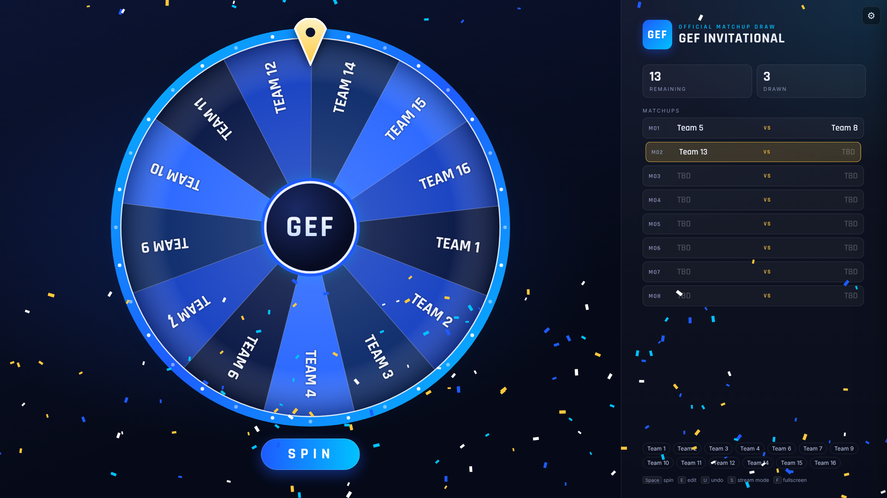

# GEF Matchup Draw Wheel

A single file wheel for live tournament matchup draws. No install, no server.

## Run it
Double click `index.html` to open it in Chrome or Edge.

## Use it
1. Press `E` (or the gear) to enter the event title and team names, one per line, then click **Load teams and reset draw**.
2. Upload the GEF logo in settings. It appears in the wheel center and the header.
3. Press `Space` (or click SPIN) to spin. The landed team is shown, then removed when you press `Space` again.
4. Picks are paired into matchups: pick 1 vs pick 2, pick 3 vs pick 4, and so on. Turn this off in settings for a plain draw order.

| Key | Action |
| --- | --- |
| Space / Enter | Spin, or continue after a pick |
| E | Open or close settings |
| U | Undo last pick |
| S | Stream mode (hides settings button and hints) |
| F | Fullscreen |

## Streaming (OBS)
Add a **Window Capture** of the browser in fullscreen (`F`), or a **Browser Source** pointed at the local file at 1920x1080.
Turn on "Control audio via OBS" on the browser source to capture the spin sounds.

## Brand colors
Edit the `BRAND CONFIG` block at the top of `index.html` to match official GEF hex codes.

Results are picked with the browser's cryptographic random generator, and the draw state is saved in the browser, so a refresh will not lose progress.
